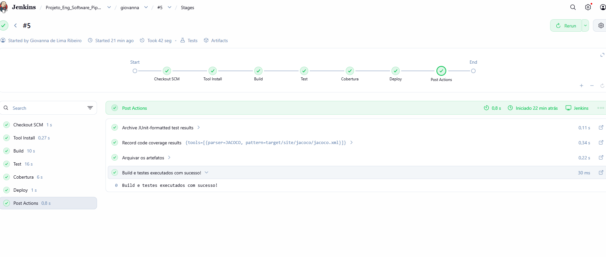

# Validação da Pipeline CI/CD — Branch giovanna

## Objetivo
Validar a integração contínua e a implantação do projeto Prestador de Serviço utilizando Jenkins e Maven incluir novas funcionalidades, como a Classe Serviço.

## Contribuição individual
- Implementação da classe `Servico.java`.
- Criação de dois testes unitários em `ServicoTest.java`.
- Execução do job da branch `giovanna` no Jenkins.

## Etapas executadas
- **Build:** compilação e empacotamento do projeto.
- **Test:** execução dos testes automatizados.
- **Cobertura:** análise e validação da cobertura com JaCoCo.
- **Deploy:** implantação local do arquivo JAR e execução de smoke test.

## Resultado
- Branch: `giovanna`
- Execução: `#5`
- Status: SUCCESS
- Duração: 42 segundos
- Stages: todos concluídos com sucesso.

## Evidências
- Captura de tela dos stages da execução #5.
  
  

## Conclusão
A pipeline executou com sucesso todas as etapas previstas, validando a integração das alterações da branch `giovanna`.